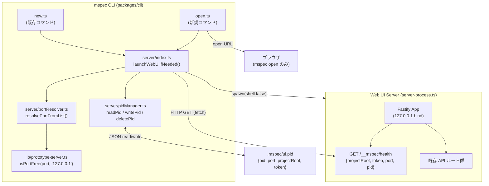
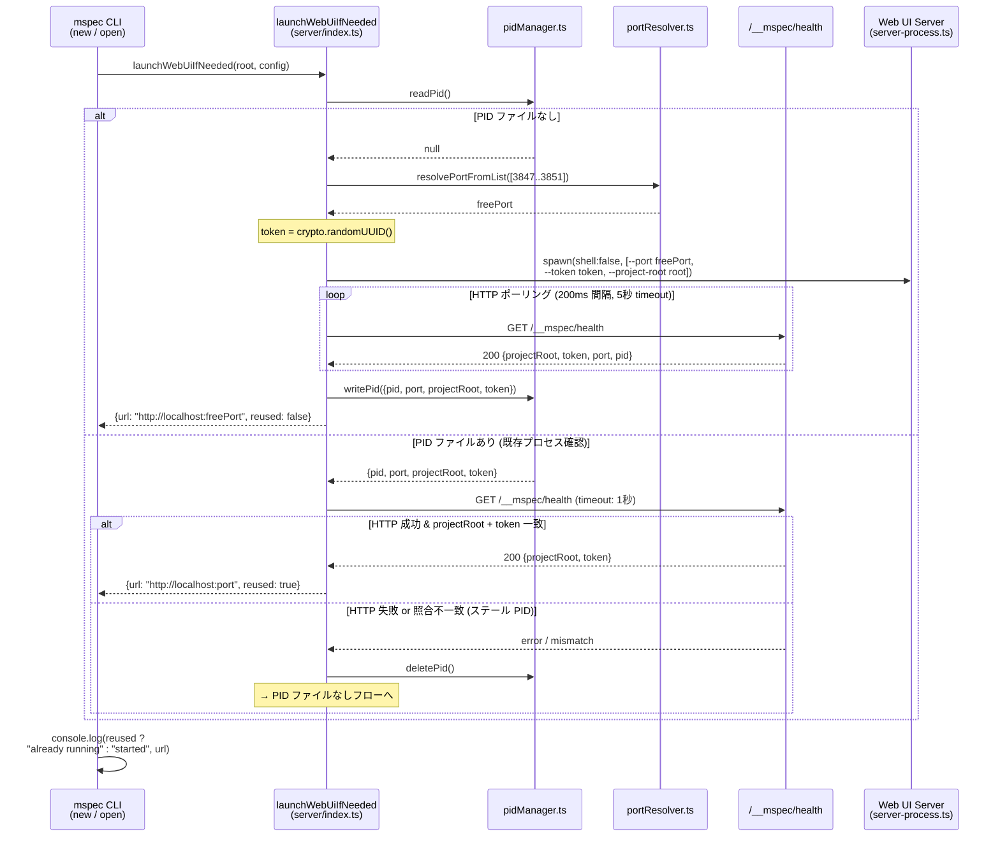
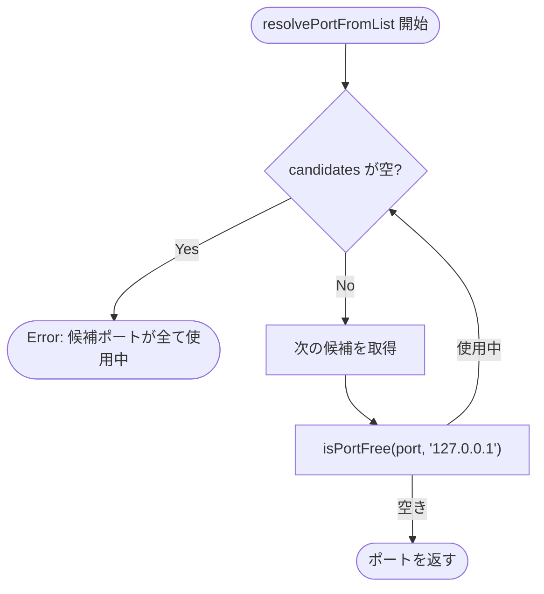

# Architecture Overview: web-ui-smart-launch

## System Context



## Sequence: スマート起動フロー



## Data Model

### PidEntry（.mspec/ui.pid）

```typescript
// packages/cli/src/server/pidManager.ts
interface PidEntry {
  pid: number;       // プロセス ID
  port: number;      // リッスンポート
  projectRoot: string; // プロジェクトルートの絶対パス
  token: string;     // crypto.randomUUID() で生成したランダムトークン
}
```

**旧フォーマット（`pid:port` プレーンテキスト）との後方互換**: JSON.parse 失敗時は `null` を返し、新規起動フローへ進む。

### /__mspec/health レスポンス

```typescript
interface HealthResponse {
  projectRoot: string;
  token: string;
  port: number;
  pid: number;
}
```

## ポート選択フロー



## セキュリティ境界

| 境界 | 対策 | 対応 FR |
|------|------|---------|
| 外部ネットワーク露出 | `127.0.0.1` 強制バインド | FR-013 |
| コマンドインジェクション | `shell: false` 明示 + ポート整数バリデーション | FR-014 |
| 別プロセスによるポート先取り | `/__mspec/health` でプロジェクト ID + トークン照合 | FR-011 |
| ステール PID による誤再利用 | HTTP ヘルスチェック失敗時に自動クリーンアップ | FR-010 |

## Constitution Check

> Step: design | Constitution Version: 1.1.0

| 原則 | Phase 0 | Phase 1 | Notes |
|------|---------|---------|-------|
| I. ステップ独立性 | ✅ | ✅ | 図は design.md / research.md のみを参照 |
| II. 決定論的マージ | ✅ | ✅ | Mermaid 図は仕様の視覚化であり、マージ対象外 |
| III. 質問駆動の要件確定 | ✅ | ✅ | 図に新たな未確定事項なし |
| IV. 双方向アンカー | ✅ | ✅ | architecture-overview は非アンカー対象文書 |
| V. 強制ステップと拡張ステップの分離 | ✅ | ✅ | ワークフロー変更なし |
| VI. Security by Default | ✅ | ✅ | セキュリティ境界テーブルで全防衛策を可視化 |
| VII. 設計意図と実装の対応確認 | ✅ | ✅ | Sequence Diagram が design.md の D-001〜D-008 と対応 |

### Complexity Tracking

None
