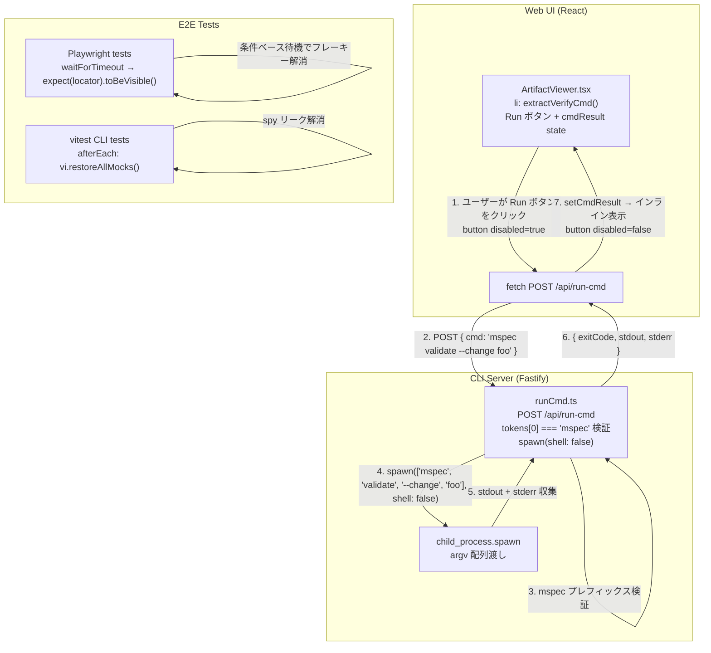
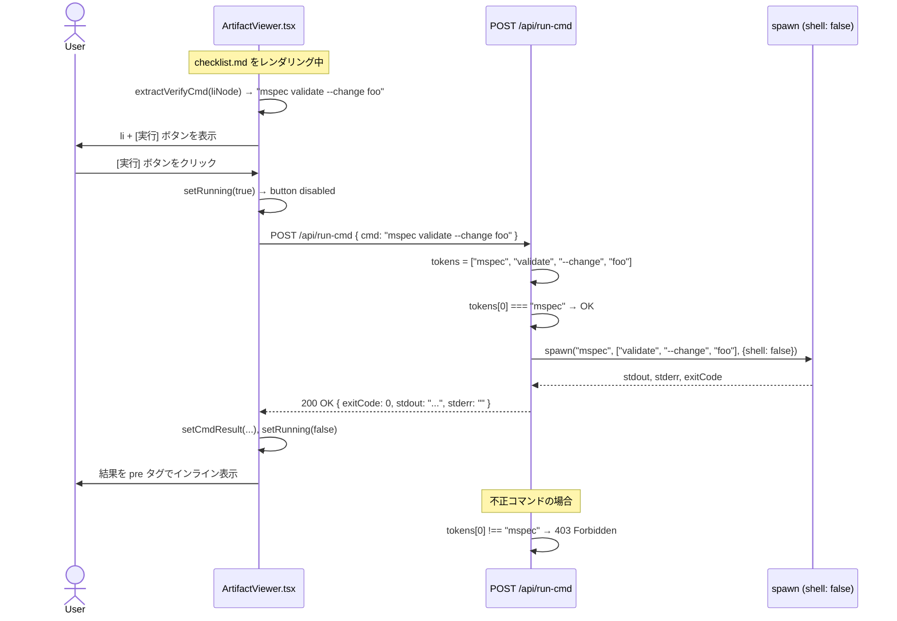
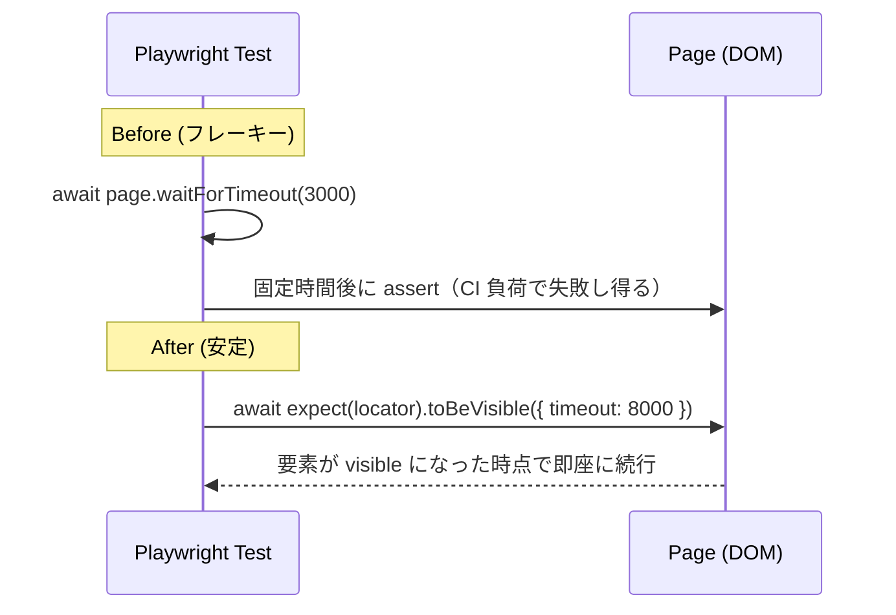

<!-- @mspec-delta 2026-05-29-133745-fix-e2e-flakiness-verify-cmd-auto-execute/specs/e2e-stability/spec.md -->
<!-- Requirements implemented: FR-001, FR-002, FR-003 -->
<!-- Change: fix-e2e-flakiness-verify-cmd-auto-execute -->

<!-- @mspec-delta 2026-05-29-133745-fix-e2e-flakiness-verify-cmd-auto-execute/specs/artifact-preview/spec.md -->
<!-- Requirements implemented: FR-014 -->
<!-- Change: fix-e2e-flakiness-verify-cmd-auto-execute -->

# Architecture Overview: fix-e2e-flakiness-verify-cmd-auto-execute

## System Diagram

---

## Sequence Diagram: FR-014 verify:cmd 実行フロー

---

## Sequence Diagram: FR-001 Playwright 待機置換

---

## 変更ファイル一覧

### e2e-stability（FR-001/002/003）

| ファイル | 変更内容 |
|---------|---------|
| `packages/web-ui/tests/e2e/spec-viewer.e2e.test.ts` | `waitForTimeout` 10件 → 条件ベース待機 |
| `packages/web-ui/tests/e2e/checklist-verify-human.e2e.test.ts` | `waitForTimeout` 4件 → 条件ベース待機 |
| `packages/web-ui/tests/e2e/code-highlight.e2e.test.ts` | `waitForTimeout` 5件 → 条件ベース待機 |
| `packages/web-ui/tests/e2e/checklist-interactive.e2e.test.ts` | `waitForTimeout` 3件 → 条件ベース待機 |
| `packages/web-ui/tests/e2e/full-text-search.e2e.test.ts` | `waitForTimeout` 3件 → 条件ベース待機 |
| `packages/web-ui/tests/e2e/artifact-preview.e2e.test.ts` | `waitForTimeout` 1件 → 条件ベース待機 |
| `packages/cli/tests/e2e/verify-llm.e2e.test.ts` | `afterEach: vi.restoreAllMocks()` 追加 |
| `packages/cli/tests/e2e/learn.e2e.test.ts` | 各 `it()` 内 `spy.mockRestore()` 追加 |

### artifact-preview（FR-014）

| ファイル | 変更内容 |
|---------|---------|
| `packages/cli/src/server/routes/runCmd.ts` | 新規: `POST /api/run-cmd` ルート実装 |
| `packages/cli/src/server/server-process.ts` | `registerRunCmdRoute` を import・登録 |
| `packages/web-ui/tests/e2e/setup/api-server.ts` | `registerRunCmdRoute` を import・登録 |
| `packages/web-ui/src/components/ArtifactViewer.tsx` | `li` に `extractVerifyCmd`・Run ボタン・結果表示を追加 |
| `packages/web-ui/tests/e2e/artifact-preview.e2e.test.ts` | FR-014 の E2E テストシナリオを追加 |

---

## Constitution Check

| 原則 | Phase 0 | Phase 1 |
|------|---------|---------|
| I — ステップ独立性 | ✅ overview は design を参照するのみ | ✅ 実装詳細に依存しない |
| II — 決定論的マージ | ✅ | ✅ |
| III — 質問駆動の要件確定 | ✅ | ✅ |
| IV — 双方向アンカー | ✅ | ✅ |
| V — 強制/拡張ステップの分離 | ✅ | ✅ |
| VI — Security by Default | ✅ spawn shell:false と mspec プレフィックス検証を図中で明示 | ✅ |
| VII — 設計意図と実装の対応確認 | ✅ 変更ファイル一覧で FR → ファイルの対応を明記 | ✅ |

### Complexity Tracking

None
