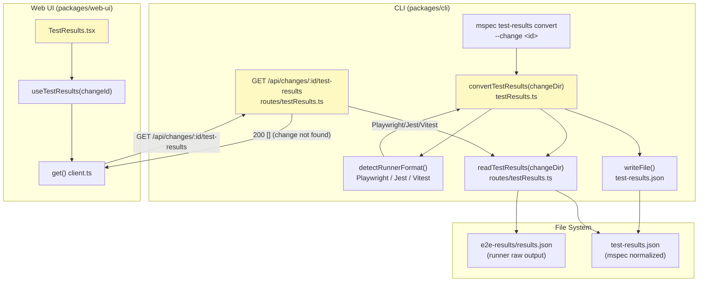
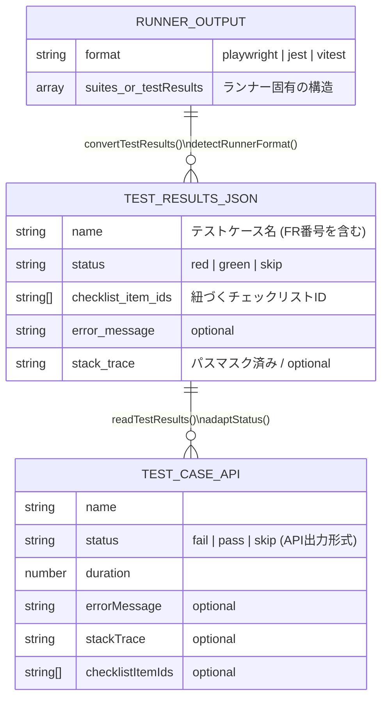

# Architecture Overview: fix-test-results-webui-display

## System Diagram



> 黄色のノードが今回修正・追加対象

---

## Sequence Diagram

```mermaid
sequenceDiagram
  participant User
  participant CLI
  participant FS as File System
  participant Server as Fastify Server
  participant WebUI as TestResults.tsx

  Note over User,CLI: ①テスト結果の生成
  User->>CLI: mspec test-results convert --change &lt;id&gt;
  CLI->>FS: read e2e-results/results.json
  CLI->>CLI: detectRunnerFormat() → Playwright/Jest/Vitest
  CLI->>CLI: convert status → red/green/skip
  CLI->>FS: write test-results.json
  CLI-->>User: ✓ test-results.json written

  Note over User,WebUI: ②WebUI での表示
  User->>WebUI: navigate to /changes/:id/test-results
  WebUI->>Server: GET /api/changes/:id/test-results
  alt change not found
    Server-->>WebUI: 200 [] (修正後: 404 → 200 [])
    WebUI-->>User: "No test results found."
  else test-results.json exists
    Server->>FS: read test-results.json
    Server-->>WebUI: 200 TestCase[]
    WebUI-->>User: テストケース一覧 (green/red/skip バッジ)
  end
```

---

## Data Model



---

## 変更ファイル一覧

| ファイル | 変更種別 | 変更内容 |
|---------|---------|---------|
| `packages/cli/src/index.ts` | 修正 | `mspec test-results convert` コマンドを登録 |
| `packages/cli/src/commands/testResults.ts` | 修正 | `detectRunnerFormat()` + Jest/Vitest 変換ロジックを追加 |
| `packages/cli/src/server/routes/testResults.ts` | 修正 | `findChange` null 時を `404` → `200 []` に変更 |
| `packages/web-ui/src/pages/TestResults.tsx` | 修正 | error state の赤エラー文言を "No test results found." に変更 |
| `packages/web-ui/tests/e2e/test-results.e2e.test.ts` | 修正 | FR-011 シナリオ（change not found の graceful 表示）を追加 |

---

## Constitution Check

| 原則 | Phase 0 | Phase 1 | 備考 |
|------|---------|---------|------|
| I. ステップ独立性 | ✅ | ✅ | 各修正ファイルは独立して変更・テスト可能 |
| II. 決定論的マージ | ✅ | ✅ | FR-011/012/013 は SoT spec に追記で衝突なし |
| III. 質問駆動の要件確定 | ✅ | ✅ | FR-013（汎用ランナー）はユーザー確認済み |
| IV. 双方向アンカー | ⚠️ | ⚠️ | アンカーは implement ステップで付与予定。現時点では未適用 |
| V. 強制ステップと拡張ステップの分離 | ✅ | ✅ | バグ修正（FR-011）と機能追加（FR-012/013）を分離 |
| VI. Security by Default | ✅ | ✅ | `maskAbsolutePaths()` によるパスマスク（FR-010）を維持 |
| VII. 設計意図と実装の対応確認 | ✅ | ✅ | design.md / design-rationale.md で意図を明記 |

### Complexity Tracking

None.
