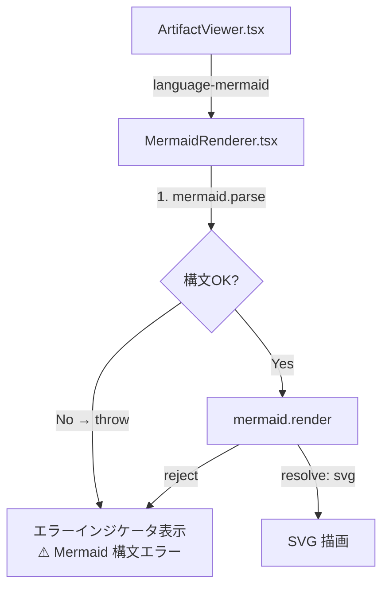
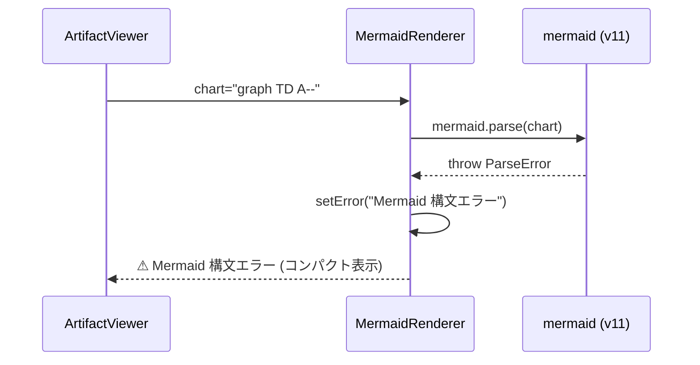
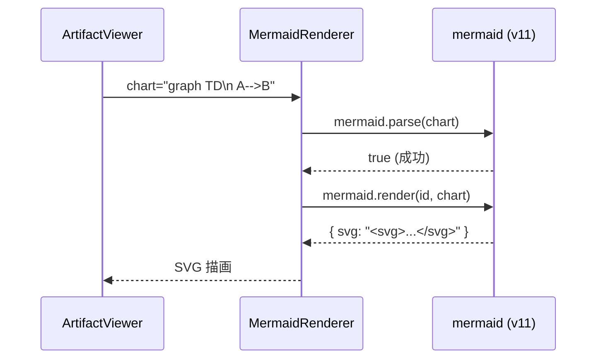

# Architecture Overview: fix-mermaid-error-display

## System Diagram

## Sequence Diagram: エラーケース（修正後）

## Sequence Diagram: 正常ケース（変更なし）

## Component Change Summary

| ファイル | 変更内容 |
|----------|----------|
| `packages/web-ui/src/components/MermaidRenderer.tsx` | `suppressErrorRendering: true` 追加、`mermaid.parse()` 事前バリデーション追加、エラー表示のコンパクト化 |

## Constitution Check

### Phase 0

| 原則 | 評価 | 備考 |
|------|------|------|
| I. ステップ独立性 | ✅ | アーキテクチャ図は design.md と独立して参照可能 |
| II. 決定論的マージ | ✅ | 図は ADDED FR のみを表現 |
| III. 質問駆動の要件確定 | ✅ | 図の構造はユーザー要求と一致 |
| IV. 双方向アンカー | ✅ | design.md が `@mspec-delta` アンカーを保持 |
| V. 強制/拡張ステップ分離 | ✅ | architecture-overview は強制ステップ |
| VI. Security by Default | ✅ | dangerouslySetInnerHTML の扱いを図に明示しない（設計上の意図的省略） |
| VII. 設計意図と実装の対応 | ✅ | シーケンス図が FR-015・FR-016 のシナリオを網羅 |

### Phase 1

| 原則 | 評価 | 備考 |
|------|------|------|
| I. ステップ独立性 | ✅ | 変更は MermaidRenderer.tsx のみ |
| II. 決定論的マージ | ✅ | |
| III. 質問駆動の要件確定 | ✅ | |
| IV. 双方向アンカー | ✅ | |
| V. 強制/拡張ステップ分離 | ✅ | |
| VI. Security by Default | ✅ | |
| VII. 設計意図と実装の対応 | ✅ | シーケンス図が FR-015・FR-016 のシナリオと 1:1 対応 |

### Complexity Tracking

None
