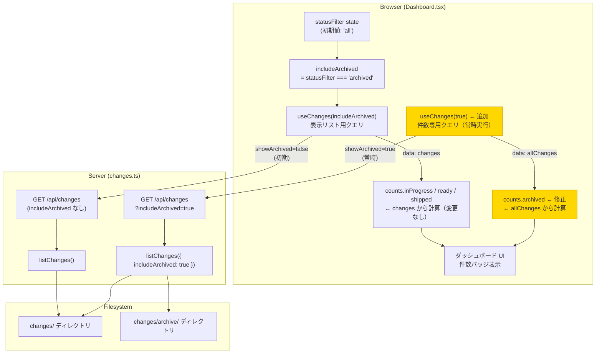
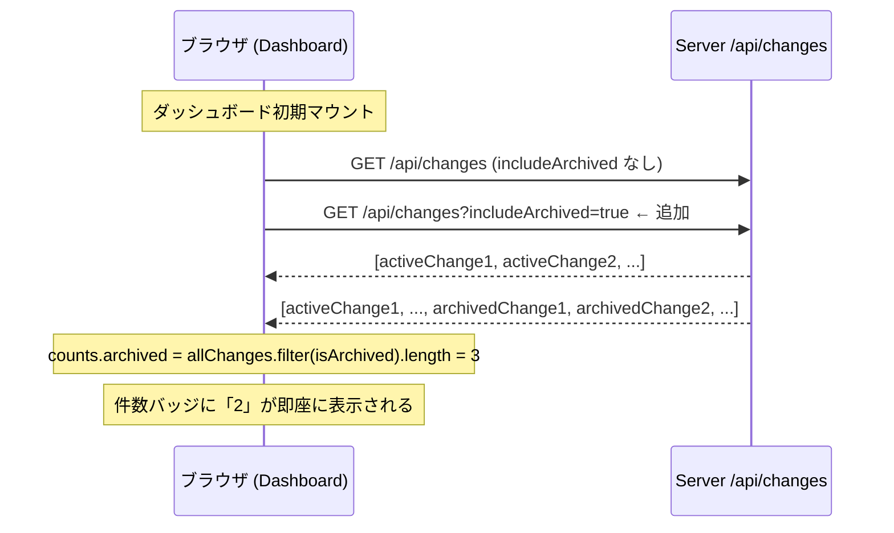

# Architecture Overview: fix-webui-archive-initial-count

## System Diagram



> 黄色のノードが今回追加・修正する箇所。

## Sequence Diagram: 初期ロード時のアーカイブ件数取得



## Data Model

変更なし。既存の `ChangeInfo` 型の `isArchived: boolean` フィールドを利用する。

```typescript
// 既存型（変更なし）
interface ChangeInfo {
  name: string;
  isArchived: boolean;
  // ...
}

// Dashboard.tsx での変更後の状態管理
const { data: changes = [] }    = useChanges(includeArchived);  // 変更なし
const { data: allChanges = [] } = useChanges(true);             // 追加
```

## Constitution Check

| 原則 | Phase 0 | Phase 1 | 備考 |
|------|---------|---------|------|
| I. ステップ独立性 | ✅ | ✅ | アーキテクチャ図は design.md・research.md のみ参照 |
| II. 決定論的マージ | ✅ | ✅ | 図の変更は独立しており衝突なし |
| III. 質問駆動の要件確定 | ✅ | ✅ | 図に未確定要素なし |
| IV. 双方向アンカー | ✅ | ✅ | アンカーは tasks.md で付与予定 |
| V. 強制/拡張ステップの分離 | ✅ | ✅ | bugfix モードで適切にスキップ済み |
| VI. Security by Default | ✅ | ✅ | 読み取り専用クエリの追加のみ |
| VII. 設計意図と実装の対応確認 | ✅ | ✅ | 図が FR-011 の修正箇所を正確に反映 |

### Complexity Tracking

None.
